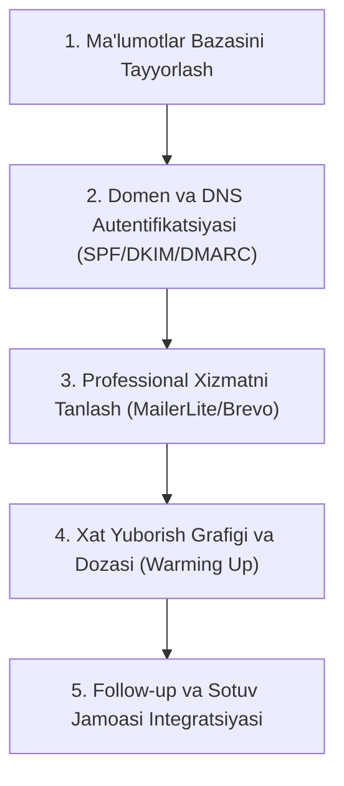
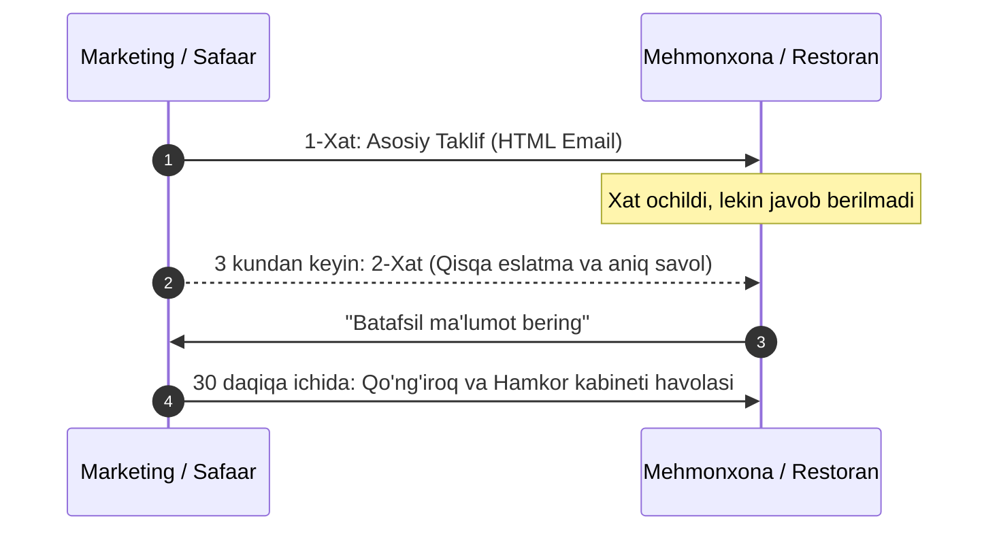

# 🚀 SAFAAR.uz — B2B Marketing Strategiyasi va Amaliy Qo'llanmasi

Ushbu hujjat **SAFAAR.uz** milliy bron qilish va turizm ekotizimiga yangi B2B hamkorlarni (mehmonxonalar, dam olish maskanlari, dachalar va restoranlarni) jalb qilish bo'yicha joriy marketing vazifalari, amaliy kontent reja, tayyor email shablonlari hamda ularni yuborish bo'yicha batafsil yo'riqnomani o'z ichiga oladi.

Farrukh va marketing jamoasi uchun taqdimot va ishchi qo'llanma sifatida mo'ljallangan.

---

## 📑 Mundarija
1. [B2B Marketing Strategiyasi va Asosiy Maqsadlar](#1-b2b-marketing-strategiyasi-va-asosiy-maqsadlar)
2. [B2B Instagram Kontent Rejasi (4 Haftalik)](#2-b2b-instagram-kontent-rejasi-4-haftalik)
3. [Instagram: 1-Post uchun Tayyor Matn (Copywriting)](#3-instagram-1-post-uchun-tayyor-matn-copywriting)
4. [B2B Email Rassilka HTML Shablonlari](#4-b2b-email-rassilka-html-shablonlari)
   - [4.1. Mehmonxonalar va Turar Joylar uchun HTML Shablon](#41-mehmonxonalar-va-turar-joylar-uchun-html-shablon)
   - [4.2. Restoranlar va Gastronomiya Maskanlari uchun HTML Shablon](#42-restoranlar-va-gastronomiya-maskanlari-uchun-html-shablon)
5. [Email Rassilkani Yuborish Bo'yicha Bosqichma-bosqich Yo'riqnoma](#5-email-rassilkani-yuborish-boyicha-bosqichma-bosqich-yoriqnoma)
6. [Follow-up (Qayta Aloqa) Zanjiri va Skriptlar](#6-follow-up-qayta-aloqa-zanjiri-va-skriptlar)
7. [Marketing Jamoasi uchun KPI va Mas'uliyat Taqsimoti](#7-marketing-jamoasi-uchun-kpi-va-masuliyat-taqsimoti)

---

## 1. B2B Marketing Strategiyasi va Asosiy Maqsadlar

### 🎯 Strategik Maqsad
Kelgusi 60 kun ichida O'zbekiston bo'ylab kamida **150+ mehmonxona, mehmon uylari, dacha majmualari** hamda **80+ mashhur restoran va kafelarni** `web-partner` platformasiga muvaffaqiyatli ulash.

### 💡 Safaar B2B Qiymat Taklifi (Value Proposition)
| Muammo (Bozordagi holat) | Safaar Yechimi | Hamkor uchun Foyda |
|---|---|---|
| **Booking.com yuqori komissiyasi (15–20%)** | 0% sinov davri, keyinchalik atigi 5–8% komissiya | Har bir bron qilingan joydan 10–12% ko'proq sof foyda |
| **Xorijiy valyuta va konvertatsiya qiyinchiligi** | To'liq O'zbekiston so'mida to'lov va to'g'ridan-to'g'ri hisob-kitob | Valyuta yo'qotishlari va bank komissiyalarisiz sof tushum |
| **Mahalliy to'lovlarning yo'qligi** | Click, Payme, Uzcard, Humo va Naqd to'lov integratsiyasi | Mijozlarga to'liq qulaylik va bekor qilishlar sonining kamayishi |
| **Kichik bizneslar uchun qimmat CRM/sayt** | Bepul shaxsiy `web-partner` boshqaruv kabineti | Kalendar, bronlar boshqaruvi, SMS xabarnomalar tekinga |
| **Mavsumiy mijozlar yetishmasligi** | Safaar platformasi orqali ichki va xorijiy sayyohlar oqimi | Yil davomida barqaror bandlik koeffitsiyenti (Occupancy Rate) |

---

## 2. B2B Instagram Kontent Rejasi (4 Haftalik)

Instagram B2B sahifasi (@safaar.partner yoki asosiy sahifadagi B2B rukni) mehmonxona egalari, administratorlar, restatorlar va turizm tadbirkorlariga qaratilgan bo'ladi.

### 📅 Hafta 1: Muammo va Tanishtiruv (Awareness & Problem)
> **Asosiy g'oya:** O'zbekiston mehmonxona va restoran biznesining og'riqli nuqtalarini ko'rsatish va Safaar brendini tanishtirish.

| Kun | Format | Mavzu | Post Maqsadi & CTA |
|---|---|---|---|
| **Dushanba** | Karusel (5 slayd) | **"Booking.com sizdan qancha yashirin komissiya olyapti?"** | Global platformalarning baland foizlari va konvertatsiya zararini hisoblab ko'rsatish. CTA: *"Hamkorlik shartlarini bilish uchun Direct'ga yozing."* |
| **Chorshanba** | Reels (Reels video) | **"Safaar nima va u o'zbek bizneslariga qanday yordam beradi?"** | Asoschi yoki B2B menejerning jonli nutqi. Platforma interfeysi va asosiy afzalliklari. CTA: *"Bio'dagi havola orqali ro'yxatdan o'ting."* |
| **Juma** | Yagona Post / Infografika | **"Birinchi 100 ta hamkor uchun: 0% Komissiya davri!"** | Cheklangan taklif. Ilk qo'shilgan hamkorlar uchun eksklyuziv bepul sinov paketi. CTA: *"Joyingizni band qilish uchun havola orqali o'ting."* |
| **Shanba** | Stories Seriyasi | **Qisqa so'rovnoma & Q&A:** *"Siz ko'proq qaysi to'lov tizimidan foydalanasiz?"* | Interaktivlikni oshirish, tadbirkorlarning ehtiyojlarini o'rganish. |

---

### 📅 Hafta 2: Raqamlar, Daromad va To'lovlar (Financial Value)
> **Asosiy g'oya:** B2B mijozga aniq moliyaviy foydani raqamlar bilan isbotlash.

| Kun | Format | Mavzu | Post Maqsadi & CTA |
|---|---|---|---|
| **Dushanba** | Karusel (Case / Hisob-kitob) | **"Oyiga 50 mln so'mlik bron: Global tizim vs Safaar.uz"** | 2 ta ustunda aniq solishtirma: qancha komissiya tejaladi va biznes hisobida qoladi. CTA: *"Tejamkorlik kalkulyatorini Direct'da sinab ko'ring."* |
| **Chorshanba** | Reels (Screen record + Voice) | **"Mijoz qanday to'laydi? Payme, Click, Humo, Uzcard bitta joyda"** | Sayyoh va mijoz uchun qulaylik: kartadan to'g'ridan-to'g'ri yechish va darhol tasdiq. CTA: *"To'lovlarni qabul qilishni boshlash uchun profilingizni oching."* |
| **Juma** | Ekspert Posti | **"Mehmonxona yoki dacha egalari nima uchun bronlarni daftarga yozmasligi kerak?"** | Avtomatlashtirishning zarurligi, inson omili xatolarini (double booking) yo'qotish. CTA: *"Hamkor kabinetini bepul sinab ko'ring."* |
| **Yakshanba** | Stories Takeover | **Real-time SMS xabarnomalar qanday keladi? (Live test)** | Mijoz bron qilganda mehmonxona rahbariga keladigan SMS jarayoni. |

---

### 📅 Hafta 3: Texnologiya va Boshqaruv Qulayligi (Product Demo)
> **Asosiy g'oya:** `web-partner` platformasining zamonaviy, qulay va sodda ekanligini ko'rsatish.

| Kun | Format | Mavzu | Post Maqsadi & CTA |
|---|---|---|---|
| **Dushanba** | Karusel (UI Walkthrough) | **"Safaar Hamkor Kabineti: 3 daqiqada xonalar va narxlarni boshqaring"** | Kalendar, xonalar ro'yxati, yopiq sanalar (Blackout dates), chegirmalar menyusi. CTA: *"Demo kirish uchun Direct'ga yozing."* |
| **Chorshanba** | Reels (Mijoz nigohi) | **"Mijoz sizning ob'ektingizni qanday topadi va bron qiladi?"** | Foydalanuvchi ilovasida mehmonxona kartochkasi qanchalik jozibador ko'rinishi. CTA: *"O'z ob'ektingizni bugun joylashtiring."* |
| **Juma** | Restoranlar uchun Maxsus Post | **"Restoran va kafelar uchun Safaar: Stol bron qilish yangi darajada"** | Sayyohlar va kechki ovqat mehmonlari oqimini oshirish, depozit to'lovlarini qabul qilish. CTA: *"Restoraningizni platformaga bepul qo'shing."* |
| **Shanba** | Stories (FAQ) | **"Tez-tez beriladigan 5 ta savol: Shartnoma, to'lov muddati va soliqlar"** | B2B auditoriyada ishonch uyg'otish va huquqiy xavotirlarni bartaraf etish. |

---

### 📅 Hafta 4: Ijtimoiy Isbot va Hamkorlikka Chaqiruv (Social Proof & Conversion)
> **Asosiy g'oya:** Dastlabki hamkorlarning fikrlari, keyslar va hamkorlik shartnomasini imzolashga undash.

| Kun | Format | Mavzu | Post Maqsadi & CTA |
|---|---|---|---|
| **Dushanba** | Hamkor Intervyusi (Video/Reels) | **"Samarqanddagi mehmonxona rahbari nega Safaar'ni tanladi?"** | Haqiqiy hamkorning samimiy fikri, mahalliy to'lovlarning afzalligi haqida. CTA: *"Siz ham tizimga qo'shiling — havola bio'da."* |
| **Chorshanba** | Karusel (Gid / Yo'riqnoma) | **"Safaar'ga qanday qilib 10 daqiqada ulanish mumkin? 4 qadam"** | Ro'yxatdan o'tish -> Rasm yuklash -> Narx belgilash -> Moderator tekshiruvi. CTA: *"Hozirning o'zida birinchi xonangizni joylashtiring."* |
| **Juma** | Yakuniy Taklif Posti | **"Yangi mavsum boshlanmoqda: Safaar bilan bronlaringizni 2 barobarga oshiring"** | Yangi sayyohlik to'lqini oldidan ob'ektni joylashtirishga shoshilish chaqiruvi. CTA: *"Bepul ulanish uchun menejerimiz bilan bog'laning."* |
| **Yakshanba** | Jonli Efir (Live Q&A) | **Farrukh va marketing jamoasi bilan "O'zbekistonda turizm biznesini raqamlashtirish"** | Savollarga jonli javob, to'g'ridan-to'g'ri hamkorlik takliflari. |

---

## 3. Instagram: 1-Post uchun Tayyor Matn (Copywriting)

> **Format:** 5 slayddan iborat vizual Karusel (Carousel)  
> **Vizual Konseptsiya:** 
> - *1-slayd (Muqova):* To'q ko'k fonda aniq, qizil va oq yozuvlar: "Booking.com'ga har oy qancha ortiqcha to'layotganingizni bilasizmi?"  
> - *2-slayd:* 100 000 000 so'm aylanmadan Booking.com oladigan 15-20 mln so'm komissiya va valyuta konvertatsiyasidagi yo'qotishlar.  
> - *3-slayd:* O'zbekistonlik sayyohlar va mehmonlar xorijiy kartalarga ega emasligi sababli bronni bekor qilishi.  
> - *4-slayd:* Safaar.uz — O'zbekistondagi milliy bron platformasi: minimal komissiya, Click/Payme, Humo/Uzcard va o'zbek tilidagi qulay panel.  
> - *5-slayd:* "Ilk 100 ta hamkor uchun maxsus taklif: 0% komissiya bilan ulanish!"

### 📝 Post Matni (Caption):

```markdown
Har bir bron uchun 18% komissiya to'lashdan charchadingizmi? 💸

O'zbekistondagi ko'plab mehmonxona, dacha va dam olish maskanlari rahbarlari xalqaro platformalardan foydalanganda quyidagi qiyinchiliklarga duch kelishadi:

❌ Xorijiy platformalarning 15–20% gacha bo'lgan yuqori komissiyasi;
❌ Mahalliy Humo, Uzcard, Click va Payme to'lovlarining yo'qligi;
❌ Chet el valyutasidagi hisob-kitoblar va noqulay konvertatsiya;
❌ O'zbek tilida texnik qo'llab-quvvatlashning mavjud emasligi.

Biz bu muammolarni hal qilish uchun SAFAAR.uz platformasini yaratdik! 🇺🇿

Safaar — bu O'zbekistondagi mehmonxonalar, dam olish maskanlari va restoranlarni sayyohlar hamda mahalliy mehmonlar bilan birlashtiruvchi yagona milliy ekotizim.

Siz Safaar bilan nimalarga ega bo'lasiz?
✅ Past komissiya stavkalari (boshqa platformalardan 2-3 barobar arzon);
✅ Humo, Uzcard, Click, Payme va naqd pul orqali qulay mahalliy to'lovlar;
✅ Barcha tushumlar to'g'ridan-to'g'ri milliy valyutada (so'mda) hisob raqamingizga;
✅ 3 daqiqada boshqariladigan zamonaviy shaxsiy hamkor kabineti;
✅ 24/7 o'zbek tilidagi tezkor qo'llab-quvvatlash xizmati.

🎁 EKSKLYUZIV TAKLIF:
Tizimga ilk qo'shilgan 100 ta mehmonxona va turar joy egalari uchun 60 kun davomida 0% KOMISSIYA bilan ishlash imkoniyatini taqdim etamiz!

Hamkorlik shartlari bilan tanishish va tizimga bepul ulanish uchun:
👉 Direct'ga "HAMKOR" so'zini yozing yoki bio'dagi havola orqali ro'yxatdan o'ting!

📞 Aloqa: +998 (71) 200-XX-XX
🌐 Sayt: partner.safaar.uz

#safaar #safaaruz #turizm #mehmonxona #tashkenthotels #samarkand #bukhara #uzbekistan_travel #dacha #restoran #biznes #b2buzbekistan #mehmonxonabiznesi
```

---

## 4. B2B Email Rassilka HTML Shablonlari

Email xatlari professional korporativ ko'rinishda, barcha asosiy pochta dasturlarida (Gmail, Outlook, Apple Mail, Mail.ru) 100% moslashuvchan (responsive) bo'lishi uchun inline CSS yordamida loyihalashtirilgan.

---

### 4.1. Mehmonxonalar va Turar Joylar uchun HTML Shablon

> **Fayl nomi:** `email-templates/hotel-b2b-offer.html`  
> **Mavzu (Subject Line):** `{Hotel_Nomi}` uchun Safaar.uz'dan hamkorlik taklifi: 0% komissiya va ko'proq mehmonlar  
> **Preheader:** O'zbekistonning milliy bron ekotizimiga ulaning va har bir brondan ko'proq daromad oling.

```html
<!DOCTYPE html>
<html lang="uz">
<head>
  <meta charset="UTF-8">
  <meta name="viewport" content="width=device-width, initial-scale=1.0">
  <title>Safaar.uz — Mehmonxonalar uchun Hamkorlik Taklifi</title>
  <style>
    body { margin: 0; padding: 0; background-color: #f4f6f9; font-family: -apple-system, BlinkMacSystemFont, 'Segoe UI', Roboto, Helvetica, Arial, sans-serif; color: #1e293b; -webkit-font-smoothing: antialiased; }
    table { border-collapse: collapse; }
    img { border: 0; display: block; outline: none; text-decoration: none; }
    .btn:hover { background-color: #1d4ed8 !important; }
    @media only screen and (max-width: 620px) {
      .container { width: 100% !important; }
      .content-padding { padding: 24px 18px !important; }
      .col { display: block !important; width: 100% !important; margin-bottom: 16px; }
      .stat-number { font-size: 26px !important; }
    }
  </style>
</head>
<body style="margin: 0; padding: 0; background-color: #f4f6f9;">
  <center>
    <table role="presentation" width="100%" border="0" cellpadding="0" cellspacing="0" style="background-color: #f4f6f9; padding: 30px 10px;">
      <tr>
        <td align="center">
          
          <!-- Asosiy Konteyner (600px) -->
          <table role="presentation" class="container" width="600" border="0" cellpadding="0" cellspacing="0" style="background-color: #ffffff; border-radius: 16px; overflow: hidden; box-shadow: 0 4px 20px rgba(0, 0, 0, 0.06);">
            
            <!-- Header (Brend banneri) -->
            <tr>
              <td style="background: linear-gradient(135deg, #0f172a 0%, #1e3a8a 100%); padding: 36px 32px; text-align: left;">
                <table width="100%" border="0" cellpadding="0" cellspacing="0">
                  <tr>
                    <td>
                      <span style="font-size: 28px; font-weight: 800; color: #ffffff; letter-spacing: -0.5px;">SAFAAR<span style="color: #38bdf8;">.uz</span></span>
                      <p style="margin: 6px 0 0 0; color: #94a3b8; font-size: 13px; font-weight: 500; text-transform: uppercase; letter-spacing: 1px;">O'zbekiston Milliy Bron Ekotizimi</p>
                    </td>
                    <td align="right">
                      <span style="display: inline-block; background-color: rgba(56, 189, 248, 0.15); color: #38bdf8; border: 1px solid rgba(56, 189, 248, 0.3); font-size: 12px; font-weight: 600; padding: 6px 14px; border-radius: 20px;">B2B Hamkorlik</span>
                    </td>
                  </tr>
                </table>
              </td>
            </tr>

            <!-- Asosiy Matn Qismi -->
            <tr>
              <td class="content-padding" style="padding: 36px 36px 24px 36px;">
                <h1 style="font-size: 22px; font-weight: 700; color: #0f172a; margin: 0 0 16px 0; line-height: 1.35;">
                  Hurmatli <span style="color: #2563eb;">{{hotel_name}}</span> rahbariyati va bron menejeri!
                </h1>
                <p style="font-size: 15px; color: #475569; line-height: 1.65; margin: 0 0 20px 0;">
                  O'zbekistonda yangi sayyohlik mavsumi qizg'in pallaga kirmoqda. Sizning mehmonxonangiz mahalliy va xorijiy sayyohlar orasida o'z obro'siga ega. Biroq xalqaro platformalar orqali bronlarni qabul qilishda har oy o'rtacha <strong>15–20% gacha yuqori komissiya</strong> va konvertatsiya xarajatlariga duch kelayotganingiz sir emas.
                </p>
                <p style="font-size: 15px; color: #475569; line-height: 1.65; margin: 0 0 28px 0;">
                  <strong>SAFAAR.uz</strong> — bu O'zbekiston mehmonxona, dacha va dam olish maskanlari uchun yaratilgan milliy bron platformasi. Biz mahalliy biznesni qo'llab-quvvatlaymiz va sizga har bir xonadan ko'proq sof foyda olish imkonini taqdim etamiz.
                </p>

                <!-- Afzalliklar Bloklari -->
                <table width="100%" border="0" cellpadding="0" cellspacing="0" style="margin-bottom: 28px;">
                  <tr>
                    <td style="padding: 16px; background-color: #f8fafc; border-left: 4px solid #2563eb; border-radius: 0 10px 10px 0; margin-bottom: 12px;">
                      <table width="100%" border="0" cellpadding="0" cellspacing="0">
                        <tr>
                          <td width="36" valign="top" style="font-size: 20px;">💰</td>
                          <td style="padding-left: 10px;">
                            <strong style="font-size: 15px; color: #0f172a; display: block; margin-bottom: 4px;">Atigi 5–8% komissiya (Booking.com'dan 2 barobar arzon)</strong>
                            <span style="font-size: 13px; color: #64748b; line-height: 1.5;">Ortiqcha xarajatlarni tejang va daromadingizni biznes rivojiga yo'naltiring.</span>
                          </td>
                        </tr>
                      </table>
                    </td>
                  </tr>
                  <tr><td height="12"></td></tr>
                  <tr>
                    <td style="padding: 16px; background-color: #f8fafc; border-left: 4px solid #10b981; border-radius: 0 10px 10px 0; margin-bottom: 12px;">
                      <table width="100%" border="0" cellpadding="0" cellspacing="0">
                        <tr>
                          <td width="36" valign="top" style="font-size: 20px;">💳</td>
                          <td style="padding-left: 10px;">
                            <strong style="font-size: 15px; color: #0f172a; display: block; margin-bottom: 4px;">Mahalliy to'lovlar: Click, Payme, Uzcard va Humo</strong>
                            <span style="font-size: 13px; color: #64748b; line-height: 1.5;">Mijozlar to'lovni bir zumda amalga oshiradi, pul to'g'ridan-to'g'ri so'mda hisobingizga keladi.</span>
                          </td>
                        </tr>
                      </table>
                    </td>
                  </tr>
                  <tr><td height="12"></td></tr>
                  <tr>
                    <td style="padding: 16px; background-color: #f8fafc; border-left: 4px solid #f59e0b; border-radius: 0 10px 10px 0;">
                      <table width="100%" border="0" cellpadding="0" cellspacing="0">
                        <tr>
                          <td width="36" valign="top" style="font-size: 20px;">📱</td>
                          <td style="padding-left: 10px;">
                            <strong style="font-size: 15px; color: #0f172a; display: block; margin-bottom: 4px;">Qulay Shaxsiy Kabinet va SMS Bildirishnomalar</strong>
                            <span style="font-size: 13px; color: #64748b; line-height: 1.5;">Xonalar narxi va bandligini real vaqt rejimida boshqaring, har bir bron haqida SMS xabar oling.</span>
                          </td>
                        </tr>
                      </table>
                    </td>
                  </tr>
                </table>

                <!-- Maxsus Taklif Banneri -->
                <table width="100%" border="0" cellpadding="0" cellspacing="0" style="background: linear-gradient(135deg, #eff6ff 0%, #dbeafe 100%); border: 1px dashed #3b82f6; border-radius: 12px; margin-bottom: 30px;">
                  <tr>
                    <td style="padding: 22px; text-align: center;">
                      <span style="font-size: 13px; font-weight: 700; color: #1d4ed8; text-transform: uppercase; letter-spacing: 1px; display: block; margin-bottom: 6px;">Eksklyuziv Taklif</span>
                      <h3 style="font-size: 19px; color: #0f172a; margin: 0 0 8px 0; font-weight: 800;">Dastlabki 60 kun davomida 0% KOMISSIYA!</h3>
                      <p style="font-size: 13px; color: #3b82f6; margin: 0; line-height: 1.5;">
                        Tizimga hoziroq bepul ulaning va birinchi 2 oy davomida barcha tushumlaringizni 100% o'zingizda saqlab qoling.
                      </p>
                    </td>
                  </tr>
                </table>

                <!-- CTA Tugmasi -->
                <table width="100%" border="0" cellpadding="0" cellspacing="0" style="margin-bottom: 24px;">
                  <tr>
                    <td align="center">
                      <a href="https://partner.safaar.uz" class="btn" target="_blank" style="display: inline-block; background-color: #2563eb; color: #ffffff; font-size: 16px; font-weight: 700; text-decoration: none; padding: 16px 38px; border-radius: 10px; box-shadow: 0 4px 14px rgba(37, 99, 235, 0.35);">
                        Hamkorlikni Boshlash (Bepul Ulanish) &rarr;
                      </a>
                    </td>
                  </tr>
                </table>

                <p style="font-size: 14px; color: #64748b; text-align: center; margin: 0 0 24px 0;">
                  Yoki to'g'ridan-to'g'ri mutaxassis bilan bog'laning: <a href="tel:+998712000000" style="color: #2563eb; font-weight: 600; text-decoration: none;">+998 (71) 200-XX-XX</a>
                </p>

              </td>
            </tr>

            <!-- Footer (Quyi qism) -->
            <tr>
              <td style="background-color: #0f172a; padding: 28px 36px; text-align: center; border-top: 1px solid #1e293b;">
                <p style="font-size: 14px; font-weight: 700; color: #ffffff; margin: 0 0 6px 0;">SAFAAR.uz — Milliy Turizm Ekotizimi</p>
                <p style="font-size: 12px; color: #64748b; margin: 0 0 14px 0; line-height: 1.5;">
                  Toshkent shahri, O'zbekiston • Qo'llab-quvvatlash: <a href="mailto:partner@safaar.uz" style="color: #38bdf8; text-decoration: none;">partner@safaar.uz</a>
                </p>
                <p style="font-size: 11px; color: #475569; margin: 0;">
                  Ushbu xat sizning biznesingizga yangi mijozlar jalb qilish maqsadida yuborildi. Agar boshqa xabarlar olishni istamasangiz, <a href="{{unsubscribe_url}}" style="color: #64748b; text-decoration: underline;">obunani bekor qiling</a>.
                </p>
              </td>
            </tr>

          </table>

        </td>
      </tr>
    </table>
  </center>
</body>
</html>
```

---

### 4.2. Restoranlar va Gastronomiya Maskanlari uchun HTML Shablon

> **Fayl nomi:** `email-templates/restaurant-b2b-offer.html`  
> **Mavzu (Subject Line):** `{Restoran_Nomi}` uchun Safaar.uz'dan taklif: Sayyohlar va mehmonlar oqimini 40% ga oshiring  
> **Preheader:** Restoraningizda stollarni oldindan bron qilish tizimi va minglab yangi mehmonlar.

```html
<!DOCTYPE html>
<html lang="uz">
<head>
  <meta charset="UTF-8">
  <meta name="viewport" content="width=device-width, initial-scale=1.0">
  <title>Safaar.uz — Restoranlar uchun Hamkorlik Taklifi</title>
  <style>
    body { margin: 0; padding: 0; background-color: #fafaf9; font-family: -apple-system, BlinkMacSystemFont, 'Segoe UI', Roboto, Helvetica, Arial, sans-serif; color: #1c1917; -webkit-font-smoothing: antialiased; }
    table { border-collapse: collapse; }
    img { border: 0; display: block; outline: none; text-decoration: none; }
    .btn:hover { background-color: #ea580c !important; }
    @media only screen and (max-width: 620px) {
      .container { width: 100% !important; }
      .content-padding { padding: 24px 18px !important; }
      .col { display: block !important; width: 100% !important; margin-bottom: 16px; }
    }
  </style>
</head>
<body style="margin: 0; padding: 0; background-color: #fafaf9;">
  <center>
    <table role="presentation" width="100%" border="0" cellpadding="0" cellspacing="0" style="background-color: #fafaf9; padding: 30px 10px;">
      <tr>
        <td align="center">
          
          <!-- Asosiy Konteyner (600px) -->
          <table role="presentation" class="container" width="600" border="0" cellpadding="0" cellspacing="0" style="background-color: #ffffff; border-radius: 16px; overflow: hidden; box-shadow: 0 4px 20px rgba(0, 0, 0, 0.05);">
            
            <!-- Header (Gastronomiya dizayni: To'q jigarrang / Zarg'aldoq aksent) -->
            <tr>
              <td style="background: linear-gradient(135deg, #1c1917 0%, #44403c 100%); padding: 36px 32px; text-align: left;">
                <table width="100%" border="0" cellpadding="0" cellspacing="0">
                  <tr>
                    <td>
                      <span style="font-size: 28px; font-weight: 800; color: #ffffff; letter-spacing: -0.5px;">SAFAAR<span style="color: #f97316;">.uz</span></span>
                      <p style="margin: 6px 0 0 0; color: #a8a29e; font-size: 13px; font-weight: 500; text-transform: uppercase; letter-spacing: 1px;">Restoranlar va Stol Bron Qilish Tizimi</p>
                    </td>
                    <td align="right">
                      <span style="display: inline-block; background-color: rgba(249, 115, 22, 0.15); color: #fb923c; border: 1px solid rgba(249, 115, 22, 0.3); font-size: 12px; font-weight: 600; padding: 6px 14px; border-radius: 20px;">HoReCa Hamkorlik</span>
                    </td>
                  </tr>
                </table>
              </td>
            </tr>

            <!-- Asosiy Matn Qismi -->
            <tr>
              <td class="content-padding" style="padding: 36px 36px 24px 36px;">
                <h1 style="font-size: 22px; font-weight: 700; color: #1c1917; margin: 0 0 16px 0; line-height: 1.35;">
                  Hurmatli <span style="color: #f97316;">{{restaurant_name}}</span> jamoasi!
                </h1>
                <p style="font-size: 15px; color: #57534e; line-height: 1.65; margin: 0 0 20px 0;">
                  O'zbekistonga tashrif buyurayotgan sayyohlar va shahar aholisining 80% dan ortig'i turar joy tanlagandan so'ng eng yaxshi milliy va zamonaviy restoranlarni qidiradi. Ko'pincha stollarni oldindan band qilish mexanizmi yo'qligi sababli restoranlar o'zlarining potentsial mehmonlarini yo'qotmoqda.
                </p>
                <p style="font-size: 15px; color: #57534e; line-height: 1.65; margin: 0 0 28px 0;">
                  <strong>SAFAAR.uz</strong> platformasi sizga shaharga kelayotgan barcha mehmonlar, sayyohlik guruhlari va mahalliy mijozlarga to'g'ridan-to'g'ri chiqish va <strong>stollarni oldindan qulay bron qilish</strong> tizimini taqdim etadi.
                </p>

                <!-- Restoran uchun 3 ta Asosiy Foyda -->
                <table width="100%" border="0" cellpadding="0" cellspacing="0" style="margin-bottom: 28px;">
                  <tr>
                    <td style="padding: 16px; background-color: #fafaf9; border-left: 4px solid #f97316; border-radius: 0 10px 10px 0;">
                      <table width="100%" border="0" cellpadding="0" cellspacing="0">
                        <tr>
                          <td width="36" valign="top" style="font-size: 20px;">🍽️</td>
                          <td style="padding-left: 10px;">
                            <strong style="font-size: 15px; color: #1c1917; display: block; margin-bottom: 4px;">Kafolatlangan Mehmonlar va Depozit Bron</strong>
                            <span style="font-size: 13px; color: #78716c; line-height: 1.5;">Bekor qilishlarni (no-show) oldini olish uchun onlayn depozit to'lovini qabul qiling.</span>
                          </td>
                        </tr>
                      </table>
                    </td>
                  </tr>
                  <tr><td height="12"></td></tr>
                  <tr>
                    <td style="padding: 16px; background-color: #fafaf9; border-left: 4px solid #10b981; border-radius: 0 10px 10px 0;">
                      <table width="100%" border="0" cellpadding="0" cellspacing="0">
                        <tr>
                          <td width="36" valign="top" style="font-size: 20px;">🗺️</td>
                          <td style="padding-left: 10px;">
                            <strong style="font-size: 15px; color: #1c1917; display: block; margin-bottom: 4px;">Sayyohlar va Mahalliy Mehmonlar Oqimi</strong>
                            <span style="font-size: 13px; color: #78716c; line-height: 1.5;">Safaar orqali mehmonxona band qilgan sayyohlarga sizning restoraningiz tavsiya etiladi.</span>
                          </td>
                        </tr>
                      </table>
                    </td>
                  </tr>
                  <tr><td height="12"></td></tr>
                  <tr>
                    <td style="padding: 16px; background-color: #fafaf9; border-left: 4px solid #3b82f6; border-radius: 0 10px 10px 0;">
                      <table width="100%" border="0" cellpadding="0" cellspacing="0">
                        <tr>
                          <td width="36" valign="top" style="font-size: 20px;">📊</td>
                          <td style="padding-left: 10px;">
                            <strong style="font-size: 15px; color: #1c1917; display: block; margin-bottom: 4px;">Stollar va Joylarni Raqamli Boshqarish</strong>
                            <span style="font-size: 13px; color: #78716c; line-height: 1.5;">Oson boshqaruv paneli: vaqt bo'yicha stollarni belgilang, menyuni va narxlarni yangilang.</span>
                          </td>
                        </tr>
                      </table>
                    </td>
                  </tr>
                </table>

                <!-- Bepul Qo'shilish Bloki -->
                <table width="100%" border="0" cellpadding="0" cellspacing="0" style="background: linear-gradient(135deg, #fff7ed 0%, #ffedd5 100%); border: 1px dashed #f97316; border-radius: 12px; margin-bottom: 30px;">
                  <tr>
                    <td style="padding: 22px; text-align: center;">
                      <span style="font-size: 13px; font-weight: 700; color: #c2410c; text-transform: uppercase; letter-spacing: 1px; display: block; margin-bottom: 6px;">Bepul Hamkorlik</span>
                      <h3 style="font-size: 19px; color: #1c1917; margin: 0 0 8px 0; font-weight: 800;">Restoranlar uchun Katalogga Qo'shilish — MUTLAQO BEPUL!</h3>
                      <p style="font-size: 13px; color: #9a3412; margin: 0; line-height: 1.5;">
                        Obuna to'lovisiz o'z taomlaringiz va restoraningizni platformaga joylang va birinchi kundan mehmonlarni qabul qiling.
                      </p>
                    </td>
                  </tr>
                </table>

                <!-- CTA Tugmasi -->
                <table width="100%" border="0" cellpadding="0" cellspacing="0" style="margin-bottom: 24px;">
                  <tr>
                    <td align="center">
                      <a href="https://partner.safaar.uz" class="btn" target="_blank" style="display: inline-block; background-color: #f97316; color: #ffffff; font-size: 16px; font-weight: 700; text-decoration: none; padding: 16px 38px; border-radius: 10px; box-shadow: 0 4px 14px rgba(249, 115, 22, 0.35);">
                        Restoranni Platformaga Qo'shish &rarr;
                      </a>
                    </td>
                  </tr>
                </table>

                <p style="font-size: 14px; color: #78716c; text-align: center; margin: 0 0 24px 0;">
                  Savollaringiz bormi? Mutaxassis bilan maslahat: <a href="tel:+998712000000" style="color: #f97316; font-weight: 600; text-decoration: none;">+998 (71) 200-XX-XX</a>
                </p>

              </td>
            </tr>

            <!-- Footer -->
            <tr>
              <td style="background-color: #1c1917; padding: 28px 36px; text-align: center;">
                <p style="font-size: 14px; font-weight: 700; color: #ffffff; margin: 0 0 6px 0;">SAFAAR.uz — Milliy Gastronomiya va Bron Platformasi</p>
                <p style="font-size: 12px; color: #a8a29e; margin: 0 0 14px 0; line-height: 1.5;">
                  Toshkent, O'zbekiston • Hamkorlik: <a href="mailto:partner@safaar.uz" style="color: #fb923c; text-decoration: none;">partner@safaar.uz</a>
                </p>
                <p style="font-size: 11px; color: #78716c; margin: 0;">
                  Ushbu taklif O'zbekistondagi HoReCa korxonalari uchun mo'ljallangan. Xabarlar olishni to'xtatish uchun <a href="{{unsubscribe_url}}" style="color: #a8a29e; text-decoration: underline;">obunani bekor qiling</a>.
                </p>
              </td>
            </tr>

          </table>

        </td>
      </tr>
    </table>
  </center>
</body>
</html>
```

---

## 5. Email Rassilkani Yuborish Bo'yicha Bosqichma-bosqich Yo'riqnoma

Email marketing kampaniyasining samarali chiqishi va xatlarning SPAM papkasiga tushib qolmasligi uchun quyidagi 5 bosqichga qat'iy rioya qilinishi shart:



### 1-Bosqich: B2B Bazasini Shakllantirish va Tozalash (Lead Generation)
1. **Manbalar:**
   - 2GIS, Yandex Maps, Google Maps (O'zbekiston hududlari: Toshkent, Samarqand, Buxoro, Xiva, Zomin, Bo'stonliq/Chorvoq).
   - O'zbekiston Turizm qo'mitasi reyestridagi mehmonxonalar va sanatoriylar ro'yxati.
   - Restoranlar assotsiatsiyasi va ijtimoiy tarmoqlardagi HoReCa ob'ektlari.
2. **Filtrlash:**
   - Xususiy shaxslarning shaxsiy pochtalari emas, biznes/korporativ pochtalarni olish (`info@hotel.uz`, `booking@hotel.com`, `gm@...`).
   - Xat yuborishdan oldin bazani **NeverBounce**, **ZeroBounce** yoki **Bouncer** xizmatlarida tekshirish (Bounce Rate < 2% bo'lishi shart).

### 2-Bosqich: Texnik Tayyorgarlik va Xavfsizlik (DNS & Anti-Spam)
> [!IMPORTANT]
> Asosiy domenni (`safaar.uz`) sovuq yuborishlarda (cold outreach) xavf ostiga qo'ymaslik uchun alohida sub-domen yoki yuboruvchi domen ochish tavsiya etiladi (masalan: `mail.safaar.uz` yoki `safaar-partner.uz`).

1. **SPF Yozuvi (Sender Policy Framework):**
   ```text
   v=spf1 include:_spf.google.com include:sendgrid.net ~all
   ```
2. **DKIM (DomainKeys Identified Mail):**
   - Tanlangan emailing servisi orqali 2048-bit DKIM kalitini Cloudflare yoki DNS provayderga kiritish.
3. **DMARC (Domain-based Message Authentication):**
   ```text
   v=DMARC1; p=quarantine; rua=mailto:dmarc-reports@safaar.uz; pct=100
   ```
4. **Custom Tracking Domain:** Xatdagi havolalar provayder domeni orqali emas, o'z sub-domeningiz orqali kuzatilishini ta'minlang (`link.safaar.uz`).

### 3-Bosqich: Email Servisini Tanlash
| Servis | Tavsiya etilgan maqsadi | Narxi / Foydasi |
|---|---|---|
| **Brevo (sobiq Sendinblue)** | B2B ommaviy rassilka va tranzaksion xatlar | Kuniga 300 ta bepul, qulay drag-and-drop va HTML muharriri |
| **MailerLite** | Zamonaviy dizayn va avtomatlashtirilgan zanjirlar | Yuqori deliverability (pochta yetkazilishi), qulay interfeys |
| **Instantly.ai / Lemlist** | B2B Cold Outreach va shaxsiylashtirilgan takliflar | Domen isitish (warmup) funksiyasi mavjud |
| **Resend** | Dasturchilar uchun API va tranzaksion bildirishnomalar | Next.js/NestJS bilan mukammal integratsiya |

### 4-Bosqich: Yuborish Grafigi va Isitish (Warm-up Schedule)
B2B auditoriya uchun xatlar yuborishning eng optimal vaqtlari:
- **Eng yaxshi kunlar:** Seshanba, Chorshanba, Payshanba.
- **Eng yaxshi soatlar:** Ertalab `09:30 – 11:30` (ertalabki ish rejalashtirish paytida) va tushdan keyin `14:30 – 16:00`.
- **Dozalash tartibi:**
  - 1-3 kunlar: Kuniga 30–50 ta xat.
  - 4-7 kunlar: Kuniga 100 ta xat.
  - 2-haftadan: Kuniga 250–500 tagacha ko'paytirish.

---

## 6. Follow-up (Qayta Aloqa) Zanjiri va Skriptlar

Odatda B2B hamkorlikda birinchi xatning o'zidayoq javob berish ehtimoli 15-20% ni tashkil qiladi. Asosiy shartnomalar 2- va 3-aloqada (Follow-up) yopiladi.



### 📩 Follow-up 1 (Asosiy xatdan 3 kun o'tib yuboriladi)
**Mavzu:** Re: `{Hotel_Nomi}` uchun Safaar.uz'dan hamkorlik taklifi  
**Matn (Qisqa matnli xat ko'rinishida):**
> Assalomu alaykum, {Ism / Hurmatli hamkor}!  
> 
> 3 kun oldin sizga Safaar.uz milliy bron tizimida mehmonxonangizni 0% komissiya bilan joylashtirish bo'yicha taklif yuborgan edik.  
> 
> Bilaman, yangi mavsum oldidan rejalaringiz juda tig'iz. Qisqacha so'ramoqchi edim: 10 daqiqalik qisqa suhbat orqali platformamiz orqali bronlar oqimini qanday oshirish mumkinligini ko'rsatsak bo'ladimi?  
> 
> Qaysi vaqtda sizga qo'ng'iroq qilishimiz qulay: bugun soat 15:00 da yoki ertaga ertalab?  
> 
> Hurmat bilan,  
> Farrukh va Safaar.uz B2B jamoasi  
> 📞 +998 (71) 200-XX-XX  

---

### 📩 Follow-up 2 (7 kundan keyin yuboriladi — "Oxirgi imkoniyat")
**Mavzu:** `{Hotel_Nomi}` uchun 0% komissiya dasturi yakunlanmoqda  
**Matn:**
> Assalomu alaykum!  
> 
> Safaar.uz platformasida dastlabki 100 ta hamkor uchun ajratilgan bepul 60 kunlik sinov davri uchun joylar soni oz qolmoqda.  
> 
> Mehmonxonangizni platformada sinab ko'rish siz uchun mutlaqo xavfsiz va bepul — hech qanday yashirin to'lovlar yoki majburiyatlar yo'q.  
> 
> Agar qiziqsangiz, havola orqali 3 daqiqada ro'yxatdan o'tishingiz mumkin: [partner.safaar.uz](https://partner.safaar.uz)  
> 
> Savollaringiz bo'lsa, ushbu xatga javob yozishingiz kifoya!  

---

## 7. Marketing Jamoasi uchun KPI va Mas'uliyat Taqsimoti

### 📊 Asosiy Samaradorlik Ko'rsatkichlari (KPI)
| Ko'rsatkich (Metrika) | Minimal Maqsad | A'lo Natija |
|---|---|---|
| **Email Open Rate (Ochilishi)** | > 35% | > 48% |
| **Email Click-Through Rate (Havolaga o'tish)** | > 5% | > 9% |
| **Emailga Javoblar (Reply Rate)** | > 8% | > 14% |
| **Instagram B2B Post Reach** | 2,500+ / post | 6,000+ / post |
| **Yangi Hamkor Ro'yxatdan O'tishi (Oylik)** | 75 ta ob'ekt | 150 ta ob'ekt |
| **Sales Qo'ng'irog'i Konversiyasi (Ro'yxatdan -> Faol)** | > 50% | > 70% |

### 👥 Jamoa Rollari va Vazifalar Taqvimi
- **Farrukh (Product & Strategy Lead):**
  - Marketing strategiyasi va hamkorlik shartlarini yakuniy tasdiqlash;
  - Yirik mehmonxonalar tarmog'i va davlat turizm organlari bilan muzokaralar;
  - `web-partner` va `backend` tayyorgarligini nazorat qilish.
- **Kopirayter & SMM Menejer:**
  - 4 haftalik Instagram rejasi bo'yicha matnlar va ssenariylarni o'z vaqtida tayyorlash;
  - Direct va izohlarga 15 daqiqa ichida javob berish.
- **Grafik / Motion Dizayner:**
  - Instagram karusellari va Reels vizuallarini tayyorlash;
  - Email uchun rasmlar va piktogrammalarni brend uslubiga moslashtirish.
- **B2B Sotuv Menejeri (Outreach & Sales Lead):**
  - Mehmonxona va restoranlar bazasini yig'ish (kuniga kamida 40 ta yangi kontakt);
  - Email orqali qiziqish bildirgan ob'ektlar bilan 30 daqiqa ichida telefon orqali bog'lanish va shartnoma yuborish.

---

> [!TIP]
> Ushbu hujjat Safaar platformasi rivojlanishi va yangi funksiyalar (transport, aviachiptalar) qo'shilishi bilan doimiy yangilab boriladi. Savollar yoki takliflar bo'lsa, Farrukh bilan bog'laning.
